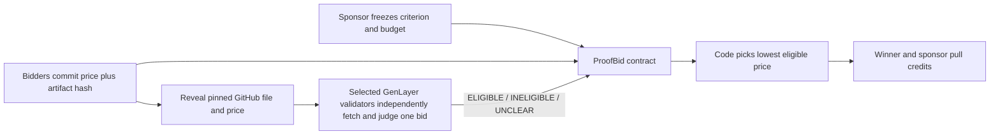

# ProofBid

ProofBid is a standalone GenLayer Native reverse auction for public, evidence-backed deliverables. A sponsor freezes one task, one observable acceptance criterion, a budget, a bid cap, and three deadlines. Bidders commit to a hidden price and a commit-pinned GitHub file. After the commit window closes, they reveal. GenLayer validators independently fetch each file, verify its raw SHA-256 and exact quote, and judge whether the complete file satisfies the single criterion. Ordinary contract code selects the lowest-priced `ELIGIBLE` bid and credits the winner and sponsor's surplus for pull withdrawal.

**Current evidence status:** Local direct-mode tests pass and StudioNet parses the contract schema under the pinned runner. A finalized live auction has **not** yet been recorded. `deploy/proof.json` intentionally says `NOT_PROVEN` until receipts, source hash, and state read-backs are verified. The hosted app, if published, must not be treated as onchain proof by itself.



## Mechanism and boundaries

- The sponsor deploys an auction, then `seal()` asks validators whether its acceptance criterion is observable from one public UTF-8 file. Only `CLEAR` terms can receive auction funding.
- `fund()` accepts up to the frozen budget. Accidental extra or unauthorized value is credited back to its sender. A partially funded auction cannot receive bids and ultimately refunds the sponsor.
- Each non-sponsor wallet gets one bid. A commitment binds the bidder address, price in wei, repository, 40-character commit SHA, path, raw file SHA-256, exact one-line quote, and a 32-byte random nonce. At capacity, commits close early; all revealed bids can start review early.
- `review_bid()` independently re-fetches the complete file on every validator. HTTP failure, a file larger than 16 KB, invalid UTF-8, body hash mismatch, or absent quote returns `UNCLEAR`. A second `UNCLEAR` finalizes that bid. The only consensus result stored is the bounded verdict; all other evidence is frozen input already stored on reveal.
- Once every bid is final, anyone can call `settle()`. At the resolution deadline, unrevealed and unreviewed bids fail closed so funding cannot stay locked. The winner is the eligible bid with the lowest revealed price, breaking ties by commitment order. If none qualifies, the sponsor receives the full budget as a credit. `withdraw()` transfers claimable GEN separately.

The contract checks a published artifact against a written rubric. It does not run migration commands, establish who authored a GitHub file, or guarantee the artifact works in production. GenLayer uses a selected committee and majority consensus, not every validator on the network. The app distinguishes transaction submission, provisional acceptance, finality, and leader execution result. A `FINALIZED` transaction with leader `ERROR` is not a successful action.

## Why this is distinct from earlier work

[Marginal Contribution Pool](https://github.com/smokexbadlines-dot/marginal-contribution-pool-genlayer) awards fixed rewards in submission order for newly covered goals. ProofBid is a sealed-price competition with one minimum-cost eligible winner and a sponsor surplus refund. [Release Covenant](https://github.com/smokexbadlines-dot/release-covenant-genlayer) carries an objection into a separate repair round. ProofBid has neither an objection nor repair: qualification is an input to a deterministic clearing rule.

## Run locally

Requires Node.js 20+, pnpm, and Python 3.12+ with `genlayer-test` and `genvm-lint` for contract checks.

```sh
pnpm install
pnpm build
pnpm dev
python -m pytest -q tests/test_proof_bid.py
node deploy/probe.mjs
```

The frontend starts without a wallet for read-only inspection. A MetaMask wallet configured for StudioNet is needed for writes. Load a finalized contract address through the Explore field or `?contract=0x...`. The app stores local transaction tracking and reveal keys in browser storage; export the reveal JSON immediately after committing and keep it private until reveal. Loss of the nonce means the committed bid cannot be revealed.

## Commitment recipe

Compute SHA-256 over the UTF-8 text below, with line feeds and no trailing line feed. `price_wei` is a decimal integer. The address, Git commit, body digest, and nonce are lowercase. The quote must be one line. The app computes the raw file digest and nonce in the browser.

```text
PROOFBID1
<lowercase 0x bidder address>
<price_wei>
<owner/repo>
<40-character git commit>
<path>
<raw UTF-8 file SHA-256>
<exact quote>
<64-character hex nonce>
```

Use `docs/partial.md` and `docs/complete.md` as an illustrative pair for the default criterion. Once this repository is public, pin both paths to the same full commit SHA, and verify that GenLayer validators can fetch them before funding a live demo.

## Proof and source

`deploy/proof.json` records the final deployment and transaction IDs when a live demo exists. `pnpm verify:proof` independently reads each transaction, checks `FINALIZED` and leader execution, checks the current source hash against the deployed source record, and reads the latest finalized auction snapshot. It deliberately fails while the manifest is pending.

Official references: [Equivalence Principle](https://docs.genlayer.com/developers/intelligent-contracts/equivalence-principle), [Optimistic Democracy](https://docs.genlayer.com/understand-genlayer-protocol/core-concepts/optimistic-democracy), [Prompt Injection](https://docs.genlayer.com/developers/intelligent-contracts/security-and-best-practices/prompt-injection).
