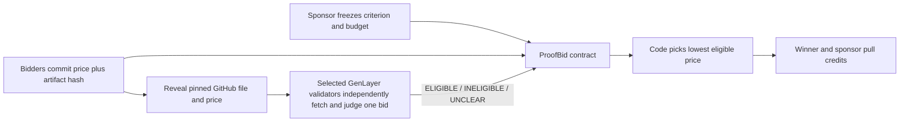

# ProofBid

ProofBid is a standalone GenLayer Native reverse auction for public, evidence-backed deliverables. A sponsor freezes one task, one observable acceptance criterion, a budget, a bid cap, and three deadlines. Bidders commit to a hidden price and a commit-pinned GitHub file. After the commit window closes, they reveal. GenLayer validators independently fetch each file, verify its raw SHA-256 and exact quote, and judge whether the complete file satisfies the single criterion. Ordinary contract code selects the lowest-priced `ELIGIBLE` bid and credits the winner and sponsor's surplus for pull withdrawal.

**Current evidence status:** A complete [StudioNet auction](https://explorer-studio.genlayer.com/address/0x0cF6733050F0c338B13ea76Aff1472ddC5755d26) is finalized. The [proof manifest](deploy/proof.json) records 13 transactions, two independent agreeing review receipts, settlement, both withdrawals, and an expected rejected reveal. Run `pnpm verify:proof` to check the receipts, pinned evidence, deployed code, and latest finalized state. The seal receipt reports leader `SUCCESS` and validator `idle`; the manifest records this precisely and does not claim validator agreement for that step. All GEN amounts in the demo are StudioNet test funds.

**Live app:** [proofbid-genlayer-20261021.opalfairy1.chatgpt.site](https://proofbid-genlayer-20261021.opalfairy1.chatgpt.site). It loads the finalized auction automatically without a wallet. A separate [browser-wallet timeout proof](deploy/browser-wallet-proof.json) records a MetaMask deployment, criterion seal, funding, sealed bid, deadline settlement, and sponsor refund withdrawal from the public app. All six finalized with successful execution and an agreeing validator receipt; `pnpm verify:wallet` rechecks them. The operator missed that bid's reveal deadline, so this proof demonstrates the fail-closed refund path, not a browser-wallet award.



## Mechanism and boundaries

- The sponsor deploys an auction, then `seal()` asks validators whether its acceptance criterion is observable from one public UTF-8 file. Only `CLEAR` terms can receive auction funding.
- `fund()` accepts up to the frozen budget. Accidental extra or unauthorized value is credited back to its sender. A partially funded auction cannot receive bids and ultimately refunds the sponsor.
- Each non-sponsor wallet gets one bid. A commitment binds the bidder address, price in wei, repository, 40-character commit SHA, path, raw file SHA-256, exact one-line quote, and a 32-byte random nonce. At capacity, commits close early; all revealed bids can start review early.
- `review_bid()` independently re-fetches the complete file on every validator. HTTP failure, a file larger than 16 KB, invalid UTF-8, body hash mismatch, or absent quote returns `UNCLEAR`. A second `UNCLEAR` finalizes that bid. The only consensus result stored is the bounded verdict; all other evidence is frozen input already stored on reveal.
- Once every bid is final, anyone can call `settle()`. At the resolution deadline, unrevealed and unreviewed bids fail closed so funding cannot stay locked. The winner is the eligible bid with the lowest revealed price, breaking ties by commitment order. If none qualifies, the sponsor receives the full budget as a credit. `withdraw()` transfers claimable GEN separately.

The contract checks a published artifact against a written rubric. It does not run migration commands, establish who authored a GitHub file, or guarantee the artifact works in production. GenLayer uses a selected committee and majority consensus, not every validator on the network. The app distinguishes transaction submission, provisional acceptance, finality, and leader execution result. A `FINALIZED` transaction with leader `ERROR` is not a successful action.

## Why this is distinct from earlier work

[PACTPROOF](https://github.com/smokexbadlines-dot/pactproof-genlayer) pays an assigned builder against preregistered grant criteria. [Marginal Contribution Pool](https://github.com/smokexbadlines-dot/marginal-contribution-pool-genlayer) awards fixed rewards in submission order for newly covered goals. ProofBid instead hides competing prices until reveal, qualifies each pinned file, then selects one minimum-cost eligible winner and returns the sponsor's surplus. [Release Covenant](https://github.com/smokexbadlines-dot/release-covenant-genlayer) carries an objection into a separate repair round; ProofBid has no objection or repair round.

## Run locally

Requires Node.js 20+, pnpm, and Python 3.12+ with `genlayer-test` and `genvm-lint` for contract checks.

```sh
pnpm install
pnpm build
pnpm dev
python -m pytest -q tests/test_proof_bid.py
node deploy/probe.mjs
```

The frontend starts without a wallet for read-only inspection. A MetaMask wallet configured for StudioNet is needed for writes. Load a finalized contract address through the Explore field or `?contract=0x...`. The app stores local transaction tracking and reveal keys in browser storage; export the reveal JSON immediately after committing and keep it private until reveal. Loss of the nonce means the committed bid cannot be revealed.

## Commitment recipe

Compute SHA-256 over the UTF-8 text below, with line feeds and no trailing line feed. `price_wei` is a decimal integer. The address, Git commit, body digest, and nonce are lowercase. The quote must be one line. The app computes the raw file digest and nonce in the browser.

```text
PROOFBID1
<lowercase 0x bidder address>
<price_wei>
<owner/repo>
<40-character git commit>
<path>
<raw UTF-8 file SHA-256>
<exact quote>
<64-character hex nonce>
```

The [partial file](docs/partial.md) and [complete file](docs/complete.md) were pinned to commit [`f625b40`](https://github.com/smokexbadlines-dot/proofbid-genlayer/tree/f625b40fd83ef7e7ab5de65cb79b61604490d430) for the live demo. The 0.2 GEN partial bid was [INELIGIBLE](https://explorer-studio.genlayer.com/tx/0xb63c253b98ccd87767b68f9815d193680ab3bdc531eecce7e7bbb27dd1bcb9a4); the 0.4 GEN complete bid was [ELIGIBLE](https://explorer-studio.genlayer.com/tx/0x52a3f6ab65dcfbc321da75ef0dff3788b13651c84e19c011c5f9952f42c50b54). Both review transactions have an independent validator receipt with an agreeing verdict. [Settlement](https://explorer-studio.genlayer.com/tx/0xaa31b1d52ff9d97a0b2dd549b66e45ba5bdd7fb3f679aaafd7ab5faf89bedb05) selected bid 2 and credited the 0.1 GEN surplus to the sponsor. The sponsor and winner later withdrew their credits.

## Proof and source

`deploy/proof.json` records the live deployment, transaction IDs, evidence digests, and expected finalized state. `pnpm verify:proof` fetches the transactions, checks `FINALIZED` and execution, confirms both review validators agreed, compares source bytes after Studio's line-ending conversion, hashes the pinned files, and reads the latest finalized snapshot and withdrawal balances. An unauthorized reveal from a different wallet is [recorded as `FINALIZED/ERROR`](https://explorer-studio.genlayer.com/tx/0x69b5a1ce321f91f83d020a8418c164fa7182f529cd0552dac823d00909eca2d5).

Official references: [Equivalence Principle](https://docs.genlayer.com/developers/intelligent-contracts/equivalence-principle), [Optimistic Democracy](https://docs.genlayer.com/understand-genlayer-protocol/core-concepts/optimistic-democracy), [Prompt Injection](https://docs.genlayer.com/developers/intelligent-contracts/security-and-best-practices/prompt-injection).
