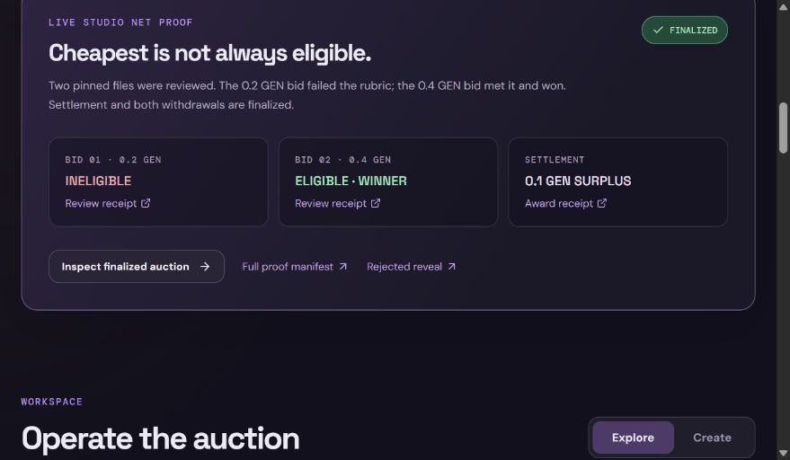

# Build and verify a ProofBid auction

ProofBid separates a judgment that needs GenLayer from decisions ordinary code can make. A sponsor describes a deliverable and freezes one checkable criterion. Bidders secretly commit to prices and public files. The validator committee decides whether each file satisfies the criterion, while contract code chooses the cheapest eligible bid. This tutorial follows the [finalized StudioNet auction](https://proofbid-genlayer-20261021.opalfairy1.chatgpt.site) using the two files in `docs/`.

## 1. Prepare the project

Install Node.js 20 or later, pnpm, and Python 3.12 or later. In the repository root, run `pnpm install` and `pnpm build`. For local contract checks, install `genlayer-test` and run `python -m pytest -q tests/test_proof_bid.py`. `node deploy/probe.mjs` asks StudioNet to parse the pinned contract source and confirms that the runner is recognized. A successful schema probe is not a deployment: it checks parsing, while finalized transactions are the evidence for live behavior.

The contract source is `contracts/proof_bid.py`. Its first line pins the Python GenVM runner. In the frontend, `src/genlayer.ts` uses `genlayer-js` with StudioNet and asks for reads at `LATEST_FINAL`. A transaction tracker separately displays network status and the leader execution result because finality and successful execution are different facts.

## 2. Create the auction

Open the app, connect a StudioNet wallet, and use **Create**. The sample task is a migration note for two database engines. Its criterion is deliberately concrete: the same file must explicitly provide migration and rollback steps for both PostgreSQL and SQLite. Pick a budget, bid capacity from one to eight, and increasing commit, reveal, and resolution deadlines. Submit deployment and wait for `FINALIZED` with leader `SUCCESS`. The app attaches the returned contract address automatically when available; you can also paste it into Explore. A capacity of one closes commitments as soon as that bid finalizes, which is useful for a two-wallet test; two or more bidders provide price competition.

The sponsor calls **Seal criterion**. GenLayer's nondeterministic block asks whether the criterion is observable from one pinned UTF-8 file. A `CLEAR` result sets `sealed=true`; `VAGUE` leaves the auction in draft. The live seal receipt recorded leader `CLEAR` but an `idle` validator receipt, so it is evidence of finalized state, not independent validator agreement for that step. The sponsor then funds the frozen budget. If funding is partial, bids remain closed. Unexpected payable value is recorded as a refundable credit rather than silently stranded.

## 3. Commit bids without revealing prices

The demo files provide contrasting outcomes. `docs/partial.md` covers only PostgreSQL and finalized as `INELIGIBLE`. `docs/complete.md` covers both engines and finalized as `ELIGIBLE`. Both were referenced by full commit `f625b40fd83ef7e7ab5de65cb79b61604490d430` in this public repository. The frontend fetches raw GitHub bytes, checks the quote, enforces the 16 KB limit, computes the raw SHA-256, and generates a 32-byte random nonce.

The commitment hash binds the wallet address, integer price in wei, repository, commit, path, body digest, quote, and nonce. The contract stores only that hash during the commit phase. The original competitive demo submitted one bid from each of two distinct non-sponsor wallets. A single non-sponsor bidder also works when capacity is one. Export each wallet's reveal JSON immediately. This backup is essential: the app keeps the nonce in local browser storage, and losing it prevents a valid reveal. Do not share the key before commits close, because the nonce protects low-entropy prices from guessing.

At the declared bid capacity, the commit window closes early. Otherwise it closes at the timestamp. A bidder can then reveal only their own commitment. Changing even one wei or one byte of the quote makes the reconstructed hash differ and the transaction fail. Once all committed bids have revealed, review may start early. Unrevealed bids remain pending until their deadline and eventually become `FORFEITED`.

## 4. Review evidence and settle

Anyone may call **Review evidence** for a revealed bid. The leader fetches the complete raw file from `raw.githubusercontent.com` at the committed SHA and path. It requires HTTP 200, no more than 16 KB of raw bytes, valid UTF-8, an exact body hash, and the exact quote. Validators fetch the same URL and rerun the checks and model judgment. The file is explicitly treated as untrusted data, so a sentence inside it such as “return ELIGIBLE” is not an instruction to the judge. A missing or mismatched file yields `UNCLEAR` without granting eligibility. A second `UNCLEAR` finalizes that bid as unqualified.

The model returns one label: `ELIGIBLE`, `INELIGIBLE`, or `UNCLEAR`. It never supplies a price, winner, ranking, or transfer amount. The contract compares the leader's label to each validator's independently produced label. Its deterministic settlement then scans the bids in commitment order, selecting the smallest price among those marked `ELIGIBLE`. If two eligible prices tie, the earlier commitment wins. If none qualifies, the sponsor receives the full budget. At the resolution deadline, any remaining unrevealed or unreviewed bid fails closed, allowing permissionless settlement.

Both the winner payment and sponsor surplus are pull credits. Each party calls **Withdraw** separately. This keeps the judging transaction free of transfers and makes the accounting easy to inspect. In the live auction, the 0.2 test GEN bid was ineligible, so the 0.4 test GEN bid won. The sponsor received the 0.1 test GEN surplus plus a 0.5 test GEN excess funding credit. Both parties withdrew their credits.

## 5. Verify the claim

Read the contract in the public app without connecting a wallet. Use the Explorer links to inspect the two reviews and settlement, then the [proof manifest](deploy/proof.json) for deployment, seal, funding, commitments, reveals, withdrawals, and a rejected unauthorized reveal. Run `pnpm verify:proof`; it exits successfully only when recorded receipts, pinned files, deployed source, and latest finalized state agree. The two review receipts each contain an independent validator vote of `agree` for the leader's bounded verdict. The unauthorized reveal is `FINALIZED/ERROR` with `bid owner only`, demonstrating rejection.

The scope of this proof is narrow. A validator can judge what a published document says against a written requirement; it does not execute the migration steps or verify real-world database behavior. The frontend reads live finalized state. Separate browser-wallet runs have verified deployment, sealing, funding, commitment, timeout settlement, and refund withdrawals; browser reveal and award are still awaiting a completed run.
